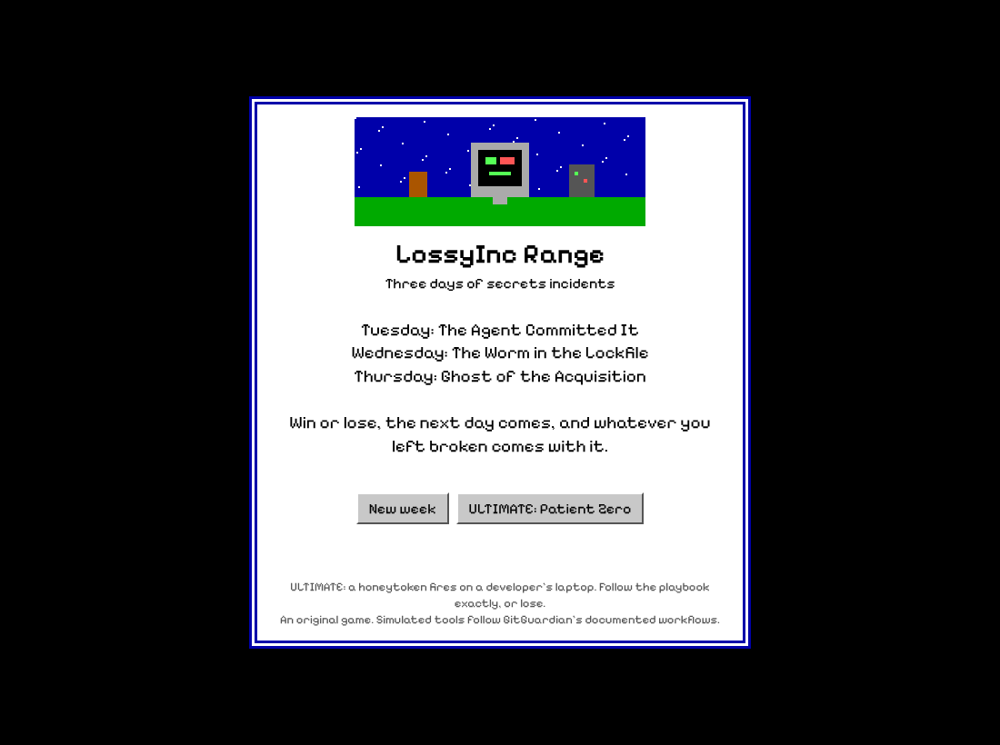
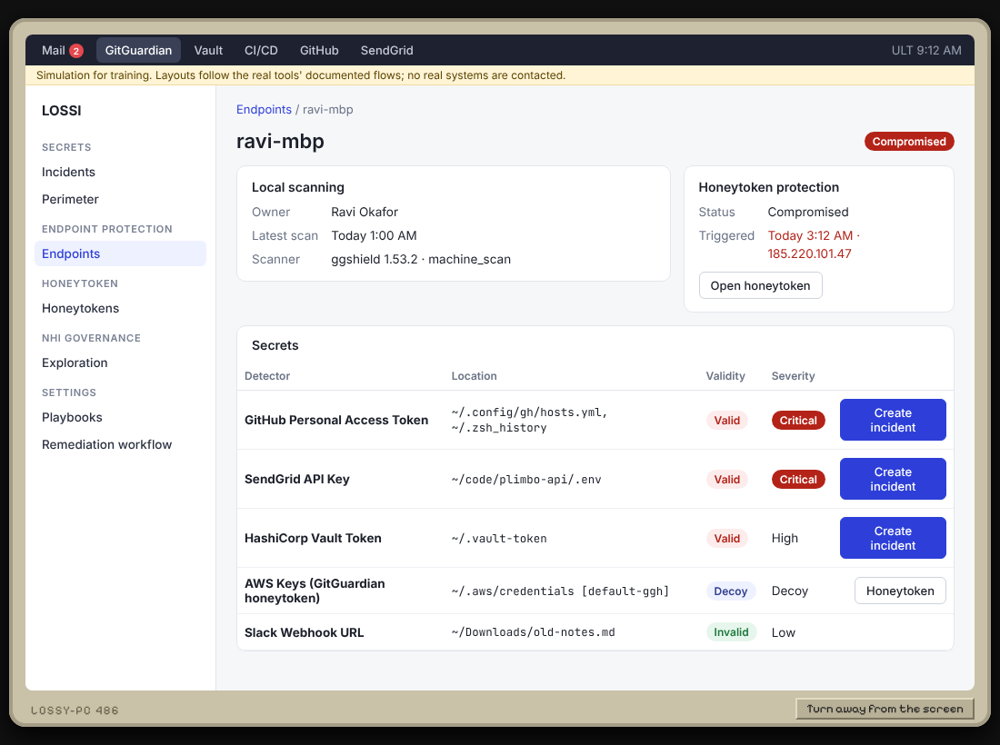
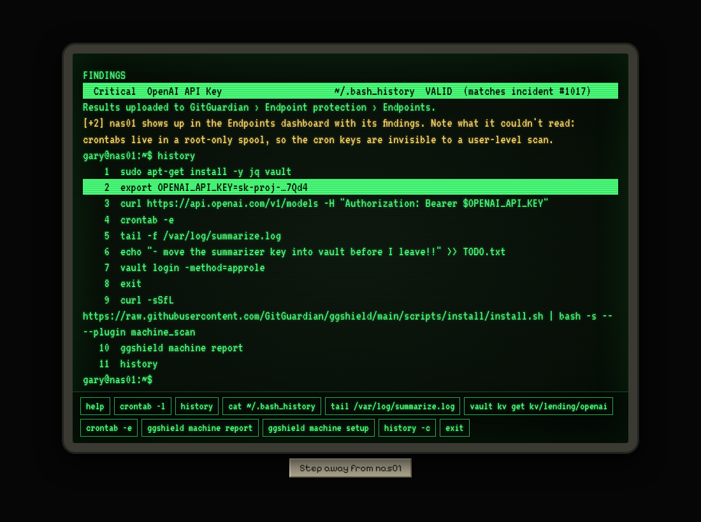

# LossyInc Range

A first-person, point-and-click adventure for practicing secrets incident response with GitGuardian. You play the newest person on the security team at a fictional company, Lossy Inc, through a working week of leaked credentials. Tuesday to Thursday are three different leaks; Friday is ULTIMATE, a compromised laptop where only the playbook wins. ULTIMATE can also be played on its own.

The pixel-art office is the game. The computer screens inside it are close imitations of the real tools, laid out the way their docs describe: GitGuardian (incidents, remediation workflow, exploration map, Endpoint protection, Honeytokens, playbooks), HashiCorp Vault, a CI/CD system, GitHub, SendGrid, Google Cloud, an AI provider console, and two Linux boxes with a working shell and nano.

**Everything is simulated.** It's one HTML file with no backend. No real system is contacted, no real credential exists, and no real tool runs: `ggshield`, `vault`, `crontab` and the rest are scripted inside the page.



## Play it

Three ways, same game:

- **Website:** open `index.html` in any browser, from disk or any static host. `python3 build.py` also writes a ready-to-host site into `site/`: a landing page at `games/lossy.html` (what the game is for, how it plays, speedrun categories, a Play button) that launches the game at `games/lossy/index.html`. Copy `site/games/` under any web root to get `<your-site>/games/lossy.html`. The `website` GitHub workflow publishes it with GitHub Pages on every push to `main` (turn Pages on once: Settings › Pages › Source: GitHub Actions); the Pages root redirects to the landing page.
- **Desktop app:** download the Windows, macOS or Linux build from the repo's Releases, or build it yourself from `app/` (see `app/README.md`).
- **Offline:** everything, fonts included, is inside `index.html`. No network needed.

**Hosting it in a games folder** (`<your-site>/games/lossy.html`). Put this repo at `games/lossy/`. Its `index.html` is the game, so `games/lossy/index.html` works as is. To rebuild after a change, run this inside `games/lossy/`:

```sh
python3 build.py --web-root ..   # rebuilds index.html here, writes ../lossy.html (landing page) and shots/
```

**Deploy to the site folder:** `npm run deploy-to-site` builds straight into `~/Documents/dwayne-mcdaniel-site/games`: the game, the landing page and the screenshots. Set `SITE_GAMES` to build somewhere else. It needs only Python, so no `npm install` first.

Opening the file directly works too:

- Double-click the file, or
- serve the folder (`python3 -m http.server 8000`, then open http://localhost:8000), or
- publish `index.html` to any static host (GitHub Pages works as is).

Progress saves to your browser's local storage; **Continue** on the title screen picks it up.

**Save codes.** Every end-of-day screen (win, loss or the end of the week) shows the code for that moment, with a Copy button. Menu → **Save code** condenses the current game into 32 bits, shown as `LR-XXXX-XXXX`. **Enter a save code** on the title screen rebuilds it on any device: the level, the time (to the nearest 6 minutes), which earlier days you won, and up to 17 milestones for the day (what's fixed, what's broken, what went public). You can type anything: a real code rebuilds your game, a mistyped one still loads (a 5-bit checksum flags about 97% of typos with a warning), and any other text is hashed into a code and gives you some game, possibly one you arrive at too late to win. **Perfect starts:** four reserved codes start a level at 9:00 AM with every earlier day at a perfect 100. That means every fix and every bonus, not just a win.

| Code | Starts | Score so far |
|---|---|---|
| `LR-PERF-TUE` | Tuesday | 0 of 400 |
| `LR-PERF-WED` | Wednesday | 100 (Tuesday perfect) |
| `LR-PERF-THU` | Thursday | 200 (Tuesday and Wednesday perfect) |
| `LR-PERF-FRI` | Friday (ULTIMATE in the week) | 300 (Tuesday to Thursday perfect) |
| `LR-PERF-ULT` | ULTIMATE on its own | 0 of 100 |

Normal codes keep their meaning: a won earlier day is rebuilt as a standard clear, not a perfect one. It's lossy on purpose: exact dialogue, timeline wording and partial progress on lost earlier days aren't kept, and points are recalculated. A Friday code also records whether it's Friday of the week or ULTIMATE on its own; for the week it keeps how many of Tuesday to Thursday were won, not which ones. The layout is documented at the top of `src/js/10b-savecode.js`.

### Controls

**New players:** **Training: how to play** on the title screen is an optional, coached Tuesday with no clock, no deadlines and no score. Part 1 covers the controls (open GitGuardian, turn away from the screen, walk to the hallway and back). Part 2 explains what the GitGuardian dashboard is showing, written for someone who has never used it.

- Click a verb (**Walk**, **Look**, **Use**, **Talk**), then click something in the scene. Or type commands in the bar: `look monitor`, `use drawer`, `talk ravi`, `go hallway`, `tasks`, `help`.
- **↩ Back to Hall** (bottom right) leaves any room; in the hallway it reads **Back to Security (your office)**.
- **Use** your monitor for the computer: a homemade Windows 3.1 (Program Manager, program groups, windows you can drag, minimize, maximize and close; on phones each program goes full-screen). Use your phone for mail. The server closet needs the badge from your desk drawer.
- The blue bar under the scene always names your **next step**. It turns red when something is urgent. **Tasks** shows the full checklist for the day.
- Each action costs in-game minutes. Deadlines are real: miss one and you get a Sierra-style death screen that explains what GitGuardian's workflow would have told you. **Restore** goes back to any earlier moment that day.

## The levels

| Day | Level | What happens | What it teaches |
|---|---|---|---|
| Tuesday | The Agent Committed It | An AI coding agent commits a valid OpenAI key into `.mcp.json`, and is about to publish a public repro. Noon loan payouts depend on that key. | Assess before acting. Find every consumer (one lives in a crontab GitGuardian has never seen), move them to the vault, then rotate and revoke without an outage. |
| Wednesday | The Worm in the Lockfile | A poisoned npm package runs in CI and publishes a GitHub token and a SendGrid key to a public repo. | Stolen credentials need containment first, then immediate revocation, then restoration. Feed CI a new secret before the worm is gone and it leaks again. |
| Thursday | Ghost of the Acquisition | A Google Cloud service account key from an acquired company turns up in a public Docker image. Nobody owns it, nobody has admin, and GitGuardian can't revoke Google Cloud keys. | Break-glass access, disable before delete, assigning an owner, and replacing a key file on a forgotten VM with the VM's own identity. |
| Friday · ULTIMATE | Patient Zero | An Endpoint Protection honeytoken fires on a developer's laptop. The attacker already took what they could. | The IR-07 playbook in your desk drawer, in exact order. Any step out of order, resetting the honeytoken, or ignoring an incident ends the run and names the step you skipped. |

**The week carries over.** Win a day by fixing everything on its checklist and telling the COO, Kofi Lopez, that it's handled. Lose it by dying. Either way the next day starts at 9:00 AM, and anything you left broken is still broken: the incident stays open, its threats come back every day until you fix it, and late fixes score half. Friday is ULTIMATE. Anything still open from Thursday goes to the on-call team, because IR-07 comes first. The week ends with a score out of 400 and a rank. **ULTIMATE on its own**, on the title screen, plays Friday alone, scored out of 100.

New games ask for your name (with a random suggestion). Machine setup only happens at a developer's desk, and once one has run it in front of you and nas01's crontab is clean, IT gives you a Device Management (MDM) program to roll it out to every laptop. Things you can do along the way that matter later: install GitGuardian Endpoint Protection on the legacy box `nas01` (the console shows the install command), scan it, plant a honeytoken, and scrub keys out of its bash history.




## Running a session

[`docs/FACILITATOR.md`](docs/FACILITATOR.md) is for anyone running this as a demo or a training: a clean path through each level, the traps and what each death teaches, and where each simulated screen comes from in GitGuardian's documentation.

## Change it

The game is built from parts in `src/` into the single file `index.html`:

```
src/head.html          title, fonts, all CSS
src/body.html          the page skeleton
src/js/01-world.js     levels, incident definitions, scoring, deadlines, deaths
src/js/02-playbook.js  ULTIMATE's IR-07 playbook and how it's enforced
src/js/03-scenes.js    pixel-art rooms and their clickable hotspots
src/js/04-interactions.js  look/use/talk, dialogue for every character
src/js/05-apps.js      the computer: Mail, Vault, CI/CD, provider consoles
src/js/05a-wm.js      the Windows 3.1 desktop: Program Manager, windows, accessible tabs
src/js/05b-slack.js    Slack: DMs with developers, replies in 2 to 200 real seconds
src/js/06-gitguardian.js   GitGuardian pages and the mail bodies
src/js/07-actions.js   dialogs and what every button does
src/js/08-hosts.js     nas01 and tvx-legacy-01: shell, nano, simulated ggshield
src/js/09-windows.js   message boxes, character dialogue, portraits
src/js/10-verbs.js     verb bar, text parser, menu, the tappable room list on phones
src/js/10b-savecode.js 32-bit save codes: encode, decode, rebuild a game
src/js/11-days.js      deaths, day transitions, checklists, saves, title screen
src/landing.html       the landing page (games/lossy.html); its screenshots are in src/landing/
```

Edit the parts, then rebuild:

```sh
python3 build.py        # writes index.html (no dependencies)
```

Commit both `src/` and the rebuilt `index.html`, so people can keep playing without building anything.

### Tests

Headless playthroughs of every level run in Node with jsdom:

```sh
npm install
npm test                 # builds, then plays: the full week, the Wednesday trap,
                         # losing Tuesday and carrying it into Wednesday, ULTIMATE
                         # by the book, and three ways of breaking the playbook
VERBOSE=1 node tests/playthrough.js week    # one scenario, with every message
```

`npm run a11y` runs axe-core (WCAG 2.2 AA rules) on every program window and drives the tabs with the keyboard; it fails on any serious or critical issue. `npm run screenshots` renders the key screens into `docs/screenshots/` with Playwright (run `npx playwright install chromium` once first).

## What else is in the repo

- `BACKLOG.md`: the running kanban of planned work.
- `docs/ROADMAP.md`: how the design got here.
- `app/`: the Electron desktop wrapper.
- `fonts/`: the bundled fonts (SIL Open Font License) that `build.py` inlines.
- `.github/workflows/`: tests on every push, the website on `main`, desktop builds on tags.
- `legacy/`: the earlier Python version of the range (company generator, scenario engine, a mock of the GitGuardian API, a terminal bridge UI) and its runbook. The game doesn't use any of it; it's kept for reference and for API-level experiments.

## Credits

An original game in the style of 1990s Sierra adventures. Lossy Inc, its business lines and its people are fictional. Simulated consoles follow the structure and wording of the products' documentation but carry no logos or brand styling.
